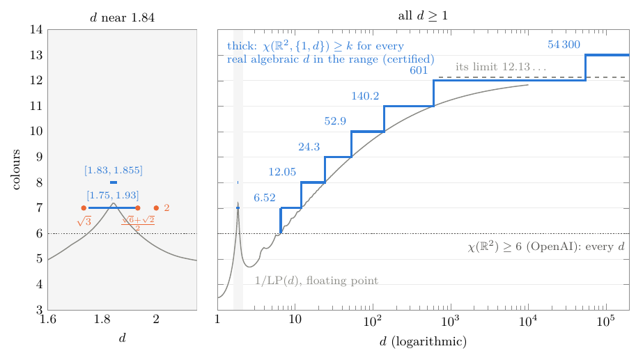

# Uniform certificates for two forbidden distances

These certificates prove Theorem 5 of [`papers/forbidden-distances/`](../../../papers/forbidden-distances/README.md):
for every real algebraic `d ≥ 1`,

| colours | for every `d` with |
|---|---|
| `χ(ℝ², {1, d}) ≥ 7` | `1.75 ≤ d ≤ 1.93` or `d ≥ 6.52` |
| `≥ 8` | `1.83 ≤ d ≤ 1.855` or `d ≥ 12.05` |
| `≥ 9` | `d ≥ 24.3` |
| `≥ 10` | `d ≥ 52.9` |
| `≥ 11` | `d ≥ 140.2` |
| `≥ 12` | `d ≥ 601` |
| `≥ 13` | `d ≥ 54 300` |

and the same for `1/d`, since `χ(ℝ², {1, 1/d}) = χ(ℝ², {1, d})`. For measurable colourings the same holds for every
real `d`. For arbitrary colourings no pair of distances was known to need 7 colours before the paper (the bound was 6;
Chybowska-Sokół, Junosza-Szaniawski and Węsek record the question as open), and the pairs certified in
[`../certificates/`](../README.md) are isolated values of `d`. For measurable colourings, Oliveira Filho and Vallentin
had 8 colours for one pair, and Bukh's theorem gives 14 or more for all `d` beyond a threshold it does not specify; there
only the explicit thresholds and ranges are new.

Each certificate is a dual solution of the linear program of Oliveira Filho and Vallentin for the two distances
`1` and `d`, in exact fractions: `g_d(t) = z0 + z1 J₀(t) + z2 J₀(dt) ≥ 0` for all `t ≥ 0` gives
`m_{1,d}(ℝ²) ≤ z0/(z0 + z1 + z2)` (Proposition 17 of the paper), and a bound below `1/(k−1)` gives
`χ(ℝ², {1, d}) ≥ k` by the transfer theorem. What is new is that one certificate covers many `d` at once.

## The certificates

- **`certificates/tail_k7.json` … `tail_k13.json`: one certificate for all `d ≥ D`** (Lemma 18 of the paper). With
  `μ = 0.4028 ≥ −min J₀` and `e(y) = min(μ, √(2/(πy)))`, we have `J₀(x) ≥ −e(y)` for every `x ≥ y > 0`. So if
  `z2 ≥ 0` and `h(t) = z0 + z1 J₀(t) − z2 e(Dt) ≥ 0` for all `t > 0`, then `g_d ≥ h ≥ 0` for every `d ≥ D`. Fields:
  `k`, `D`, `z0`, `z1`, `z2` (fractions), `bound`, and `T`, `boxes` (the end of the box covering and the number of
  boxes of `tail.py`).

  | file | `D` | bound for all `d ≥ D` | proves for `d ≥ D` |
  |---|---|---|---|
  | `tail_k7.json` | 6.52 | 0.1666308 < 1/6 | `χ ≥ 7` |
  | `tail_k8.json` | 12.3 | 0.1428093 < 1/7 | `χ ≥ 8` |
  | `tail_k9.json` | 24.3 | 0.1249785 < 1/8 | `χ ≥ 9` |
  | `tail_k10.json` | 52.9 | 0.1111073 < 1/9 | `χ ≥ 10` |
  | `tail_k11.json` | 140.2 | 0.0999955 < 1/10 | `χ ≥ 11` |
  | `tail_k12.json` | 601 | 0.0909057 < 1/11 | `χ ≥ 12` |
  | `tail_k13.json` | 54 300 | 0.0833328 < 1/12 | `χ ≥ 13` |

- **`certificates/interval_k*_a_b.json`: certificates for intervals of `d`.** A list of contiguous intervals
  `[a, b]` covering the range of the file, each with `z0, z1, z2` such that `g_d ≥ 0` for every `d` in `[a, b]`:
  `interval_k7_1.75_1.93.json` (19 intervals, `χ ≥ 7`), `interval_k8_1.83_1.855.json` (5, `χ ≥ 8`) and
  `interval_k8_12.05_12.3.json` (11, `χ ≥ 8`, joining `12.05` to the tail at `12.3`).

## The programs

Run them in this folder.
- **`tail.py check certificates/tail_k*.json`** and **`uniform.py check certificates/interval_k*.json`** re-verify
  the stored certificates; **`tail.py k D`** and **`uniform.py k a b step`** produce them. They choose the coefficients
  by a floating-point linear program (`lpcp.py` and `tail.py`'s own; nothing these compute is trusted), round them to
  fractions, raise `z0` by a third of the slack, and prove `h ≥ 0`, respectively `g_d ≥ 0` on `[a, b] × [0, ∞)`, in
  Arb ball arithmetic: they cover `[0, T]` by `t`-boxes, enclose `J₀` on an interval `[m − r, m + r]` by
  `J₀(m) ± (|J₁(m)| r + r²/2)` (since `|J₀''| ≤ 1`), by `[−μ, 1]` and by `±√(2/(πx₀))` beyond `x₀ > 0`, bisect until
  each box has a nonnegative lower bound, and use `|J₀(x)| ≤ √(2/(πx))` on `[T, ∞)`. `J₀ ≥ −0.4028` is proved by
  `check_j0min` in `uniform.py` (4000 boxes on `[0, 4]`, the envelope beyond). `tail.py 13 54300` reproduces
  `tail_k13.json` byte for byte.
- **`check_uniform.py certificates/*.json`** is a second program, written separately. It recomputes each target
  `1/(k−1)` from `k`, checks that the intervals of a file are contiguous and cover its range, looks for a
  counterexample in floating point and confirms it in Arb before rejecting, encloses `J₀` by point values and the
  Lipschitz bound `|J₁| ≤ 1/√2` instead of the Taylor bound, bisects boxes in both `t` and `d` for intervals, sweeps
  `h` with steps chosen from its value for tails, and checks `J₀ ≥ −0.4028` itself. It accepts all ten certificates
  in about twenty seconds.

Both kinds of program exit with a non-zero code when a check fails. They reject corrupted certificates (see the
tests): a lowered `z0`, a scaled `z2`, a threshold `D` moved below the certified one, a raised `k`, a gap between
intervals, a reversed interval, an interval extended below its range, and a certificate whose `g_d` has minimum
`−10⁻⁵` at a point that the floating-point scan misses.

**`figure/`**: `uniform_fig.tex` draws the figure of the paper (`pdflatex uniform_fig.tex`) from `lpcurve.dat`,
which `scan.py` computes from the floating-point values of the linear program in `lowscan.tsv` (`d` from 1.005 to 6.6)
and `logscan.tsv` (`d` from 6.6 to 10⁴). These values are not proofs. In floating point, for `d > 2`, the program gives
`k = 7, …, 12` colours from about `d = 6.503, 12.03, 23.87, 52.85, 139.9, 599.2` on, and 13 from somewhere between
50 000 and 54 300; for `1 < d < 2` it gives 7 colours only for `d` between about 1.747 and 1.934. As `d → ∞` its
value tends to `μ₀²/(1 + μ₀)² = 1/12.13…` (`μ₀ = −min J₀`), the square of its value 0.287119 for one distance, so it
gives at most 13 colours for two distances (proved for `d ≥ 20` in the remark after Lemma 18 of the paper, and seen
in floating point for every `d`).

**Tests.** From the root of the repository, `python3 -m pytest -q tests/test_forbidden_distances.py -k uniform` runs
both programs on every certificate and checks that both reject the corrupted ones (about a minute); the corruption
that the floating-point scan misses is marked slow.
